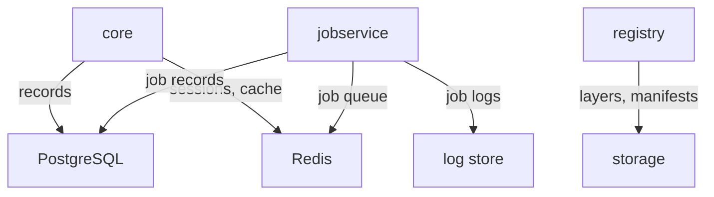

# What Harbor Keeps Where

Before you move Harbor's data, you need to know where it is. Harbor is not one program but a group of components, and each one writes a different kind of data to a different place. This part takes a running Harbor apart, component by component, and finds each kind of data on the cluster.

## The components and their data

Harbor's chart starts one Deployment or StatefulSet per component. A Deployment runs pods that keep no identity of their own; a StatefulSet runs pods with a fixed name and, usually, their own volume, which suits a database. The table lists the components and the data each one owns:

| Component | Kind | What it does | Data it writes |
| --- | --- | --- | --- |
| `core` | Deployment | Harbor's API server: users, projects, policies, and the token service the registry trusts | Records in PostgreSQL, sessions and caches in Redis |
| `portal` | Deployment | The web user interface | Nothing |
| `registry` | Deployment | Stores and serves image layers and manifests (CNCF Distribution) | Files in its storage: a directory or a bucket |
| `jobservice` | Deployment | Runs background jobs: garbage collection, replication, retention, scans | Job queue in Redis, job records in PostgreSQL, job logs |
| `database` | StatefulSet | The internal PostgreSQL, used when no external database is set | Everything in the database `registry` |
| `redis` | StatefulSet | The internal Redis, used when no external Redis is set | Queues and caches |

The diagram shows who writes where:



The diagram shows that only `core`, `jobservice` and `registry` write data; `portal` writes none, and the three stores are PostgreSQL, Redis and the registry storage, plus wherever job logs go.

Redis needs one more fact. Harbor's components share one Redis server but use separate Redis databases, which Redis numbers from 0. The chart's defaults are index `0` for `core`, `1` for `jobservice`, `2` for `registry` and `5` for the Trivy adapter, and the chart notes that `core` must stay on `0`.

## Find the data on a running Harbor

The table is the general rule; now look at a real installation. Start with the workloads in the namespace `harbor`.

<!-- astrona:playground:renew -->

```sh
kubectl -n harbor get deployments,statefulsets
```

You should see the Deployments `harbor-core`, `harbor-portal`, `harbor-jobservice` and `harbor-registry`, and the StatefulSets `harbor-database` and `harbor-redis`. Those two StatefulSets are the internal PostgreSQL and Redis. Trivy is switched off in this course, so there is no `harbor-trivy`.

The registry's storage setting lives in its configuration file, which the chart puts in the ConfigMap `harbor-registry`. Print the `storage` block of that file:

```sh
kubectl -n harbor get configmap harbor-registry -o jsonpath='{.data.config\.yml}' | grep -A3 '^storage:'
```

The block says `filesystem` with the root directory `/storage`. That directory is inside the registry pod, and in this course no PersistentVolumeClaim backs it, so the image layers live on an `emptyDir` volume and disappear with the pod.

Now look inside the internal database. The internal PostgreSQL runs as the user `postgres`, and Harbor's data is in the database `registry`:

```sh
kubectl -n harbor exec statefulset/harbor-database -- psql -U postgres -d registry -c '\dt' | head -20
```

The output lists Harbor's tables, among them `project`, `harbor_user`, `artifact` and `repository`. Everything you see in the web portal (projects, members, policies, the list of artifacts) is a row in one of these tables. The image layers are not; the database only holds their digests.

Finally, ask Harbor itself. The endpoint `/api/v2.0/health` reports the state of every component. Define a helper that runs a command in the `workstation` pod, then call the endpoint from there:

```sh
ws() { kubectl -n workstation exec -i deploy/workstation -- "$@"; }
ws curl -s https://harbor.localtest.me:8443/api/v2.0/health | ws jq .
```

The answer has an overall `status` and a list of `components`, each with a `name` and a `status`. You should see `core`, `database`, `jobservice`, `portal`, `redis`, `registry` and `registryctl`, all `healthy`. This endpoint is your first check after every change in this module.

## What moves, and what does not

Moving Harbor to external services means changing three stores. The database moves to an external PostgreSQL, Redis moves to an external Redis, and the registry storage moves to an object store. The job logs move into the database, because once Harbor keeps no files in its pods, a log file in a `jobservice` pod is the last piece of data that would be lost on a restart.

The code does not move. `core`, `portal`, `jobservice` and `registry` stay where they are, and after the move they hold nothing you cannot lose.

You now know which component writes which data, and you have seen each store on a running Harbor: the internal StatefulSets, the registry's filesystem storage and the tables in the database `registry`. The open question is how to point the chart at external services instead, starting with the database and Redis.

## Common pitfalls

> [!WARNING]
> - **Thinking the database holds the images.** PostgreSQL holds the records and the digests. The layers and manifests are in the registry storage, and both must be backed up and moved together.
> - **Forgetting the job logs.** With the default `file` logger, job logs live in the `jobservice` pod. They are the last data a move to external services leaves behind.
> - **Reading the portal as proof the data is safe.** The portal shows what the database says. It does not tell you whether the database or the storage survives a pod restart.
> - **Changing Redis database numbers.** Harbor's components share Redis by index. The chart says `core` must stay on index `0`.
