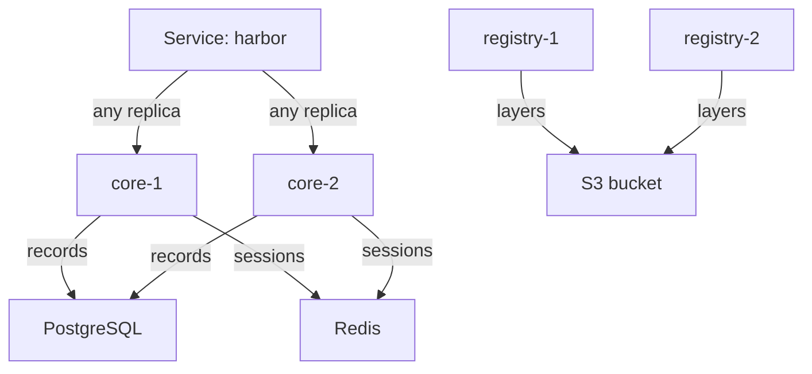

# What High Availability Needs

Adding replicas to a Deployment takes one number in the Helm values. Making those replicas useful takes more: every replica must see the same data, and every request must reach a replica that is alive. This part lists what a highly available Harbor needs, component by component, before you change a single number.

## What the Harbor guide asks for

The Harbor guide for high availability with Helm lists the parts that Harbor itself does not provide. Each one must already be highly available on its own:

| Requirement | Why Harbor needs it |
| --- | --- |
| A highly available PostgreSQL | Every `core` and `jobservice` replica reads and writes the same records |
| A highly available Redis | Every replica shares the job queue, sessions and caches |
| Shared storage: a `ReadWriteMany` volume or object storage | Every `registry` replica must read every layer, wherever it was pushed |
| A highly available ingress or load balancer | Requests must reach a live replica |

A `ReadWriteMany` (RWX) volume is one that pods on many nodes can mount for writing at the same time. Most block storage cannot do that, which is why object storage is the usual choice for the registry.

The guide then says to set `replicas` to 2 or more for `portal`, `core`, `jobservice` and `registry`. Harbor itself adds nothing else: the chart has no leader election and no clustering setting. Harbor's components are built so that any replica can answer any request, as long as the state is shared.

## What each component shares

The diagram shows two replicas of each component and the shared state behind them:



The diagram shows that the replicas of a component never talk to each other; they only meet in PostgreSQL, Redis and the bucket.

Each component has its own reason to need shared state. Two `core` replicas must agree on users and sessions, so a request that signs in on one replica and pushes through the other still works; PostgreSQL and Redis give them that. Two `jobservice` replicas take jobs from the same queue in Redis, so a job runs once, on whichever replica is free. Their logs are the catch: with the `file` logger each replica writes to its own pod, and the portal can only show a job's log if it asks the replica that ran it. The `database` logger puts every log in PostgreSQL.

The registry is the strictest. A push uploads layers through one request after another, and with two replicas those requests can land on different pods. If each replica has its own directory, one pod holds half of an image and the other pod holds the other half, and a later pull fails whenever it reaches the pod without the layer. With a shared bucket, every replica sees every layer.

## Look at the playground before scaling

The playground already runs on external services with one replica each. Confirm both facts before you scale anything.

<!-- astrona:playground:renew -->

```sh
kubectl -n harbor get deployments
helm -n harbor get values harbor -o yaml | grep -A2 -E 'type: (external|s3)|jobLoggers'
```

Each Deployment shows `1/1`. The values show `database` and `redis` with `type: external`, the storage with `type: s3`, and `jobLoggers` with `database`. That is the state the guide asks for, so this Harbor is ready to scale.

Then look at the Service that spreads the requests:

```sh
kubectl -n harbor get service harbor -o wide
kubectl -n harbor get endpointslices -l kubernetes.io/service-name=harbor
```

The Service `harbor` sends traffic on port `8443` to the pods behind it. In this course it is the chart's `nginx` proxy, which then forwards to `core`, `portal` and `registry` through their own Services. Every Service in Kubernetes only sends traffic to pods that are ready, so when a pod is deleted, the Service stops sending it requests within seconds.

## The Harbor Operator

You may find the Harbor Operator in older guides: a Kubernetes operator that created Harbor and its dependencies from a single custom resource. Its GitHub repository, `goharbor/harbor-operator`, is archived, and its last release is v1.3.0 from 2022. An archived repository receives no fixes, including security fixes, and that release predates the Harbor versions in this course. Use the `harbor-helm` chart, which the Harbor project maintains and documents.

You now know what a highly available Harbor needs: highly available PostgreSQL and Redis, shared storage for the registry, job logs in the database, and two or more replicas behind a Service. The open question is whether it really works, and that is only answered by losing pods on purpose.

## Common pitfalls

> [!WARNING]
> - **Scaling the registry on separate filesystems.** Each replica holds only the layers pushed to it, and pulls fail at random. Use object storage or a `ReadWriteMany` volume.
> - **Scaling `jobservice` with the `file` logger.** Each replica keeps its own logs, and the portal cannot show all of them.
> - **Calling Harbor highly available when PostgreSQL and Redis run once.** Harbor is only as available as the services it depends on.
> - **Following a Harbor Operator guide.** The project is archived. Use the `harbor-helm` chart.
