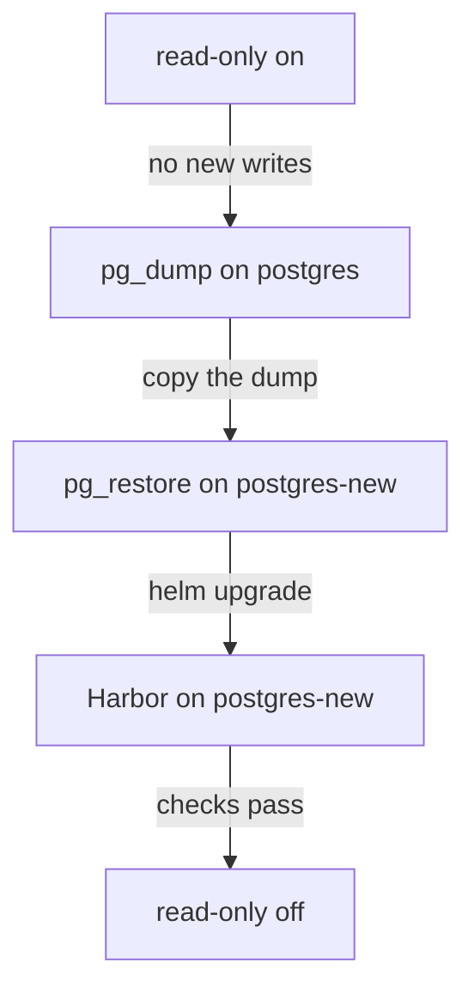

# Moving The Database With A Read-Only Window

Sooner or later Harbor's database moves: to a new PostgreSQL version, to a managed service, or to a highly available cluster. A dump and a restore copy the data, but Harbor keeps writing while the dump runs, and anything written after the dump started is not in the copy. This part moves the database to a new server with a short read-only window, so the copy and the live data are the same.

## Read-only mode

Read-only mode is a Harbor setting. The Harbor documentation on global settings describes it: Harbor allows pulls, but refuses pushes and the deletion of repositories and tags, and a push fails with the message that the system is in read only mode. Pulls keep working, so deployments that only pull images are not affected.

The setting lives in Harbor's configuration, which the API exposes at `/api/v2.0/configurations`. A `GET` returns every setting with its value; a `PUT` with a JSON body changes the settings it names. The setting is called `read_only`. The `harbor` command-line tool reads and changes the same server configuration with its `harbor config` commands; this part uses the API directly, so you see exactly what is sent.

Define two helpers. `ws` runs a command in the `workstation` pod, and `harbor_api` calls the API as the administrator, with an optional JSON body:

<!-- astrona:playground:renew -->

```sh
ws() { kubectl -n workstation exec -i deploy/workstation -- "$@"; }
harbor_api() {
  if [ -n "${3:-}" ]; then
    ws curl -sS -u admin:Harbor12345 -X "$1" -H 'Content-Type: application/json' \
      --data "$3" "https://harbor.localtest.me:8443/api/v2.0$2"
  else
    ws curl -sS -u admin:Harbor12345 -X "$1" "https://harbor.localtest.me:8443/api/v2.0$2"
  fi
}
harbor_api GET /configurations | ws jq '.read_only'
```

The answer is an object with `"value": false` and `"editable": true`: Harbor accepts writes.

## The move, step by step

The window must be short, so plan the steps before you start. The diagram shows the order:



The diagram shows that writes stop before the dump and start again only after Harbor runs on the new server and passes its checks; pulls work throughout.

Open the window:

```sh
harbor_api PUT /configurations '{"read_only":true}'
harbor_api GET /configurations | ws jq '.read_only.value'
```

The value is now `true`. Harbor's records cannot change, so dump the database on the old server and copy the dump into the new server's pod:

```sh
kubectl -n harbor-deps exec deploy/postgres -- pg_dump -U harbor -d registry -Fc -f /backup/registry.dump
kubectl -n harbor-deps exec deploy/postgres -- cat /backup/registry.dump \
  | kubectl -n harbor-deps exec -i deploy/postgres-new -- sh -c 'cat > /backup/registry.dump'
kubectl -n harbor-deps exec deploy/postgres -- wc -c /backup/registry.dump
kubectl -n harbor-deps exec deploy/postgres-new -- wc -c /backup/registry.dump
kubectl -n harbor-deps exec deploy/postgres-new -- pg_restore -U harbor -d registry --clean --if-exists /backup/registry.dump
```

The first command writes the dump and the second streams it through your machine into `postgres-new`. The two `wc -c` commands print the file size on each side; they must be equal, because `kubectl exec` can lose the end of a stream, and a short dump makes `pg_restore` fail with `input file is too short`. If the sizes differ, run the copy again. The last command restores the dump. `--clean --if-exists` drops any object before recreating it, so the restore works even if the target database is not quite empty. Check that the data arrived:

```sh
kubectl -n harbor-deps exec deploy/postgres-new -- psql -U harbor -d registry -tAc 'select name from project'
```

The new server lists the projects `library` and `inventory`.

Now point Harbor at the new server. Change one line of the installed values, the database host:

```sh
helm -n harbor get values harbor -o yaml > harbor-values.yaml
sed -i.bak 's/host: postgres.harbor-deps.svc.cluster.local/host: postgres-new.harbor-deps.svc.cluster.local/' harbor-values.yaml
grep -n 'host:' harbor-values.yaml
helm upgrade harbor harbor/harbor --version 1.19.4 --namespace harbor \
  --values harbor-values.yaml --wait --timeout 20m
```

`grep` shows the new host, and the upgrade restarts `core` and `jobservice` on `postgres-new`. Both PostgreSQL servers use the same user and password, so the Secret `harbor-external-db` does not change. Check Harbor, then close the window:

```sh
ws curl -s https://harbor.localtest.me:8443/api/v2.0/health | ws jq -r '.status'
harbor_api PUT /configurations '{"read_only":false}'
harbor_api GET /configurations | ws jq '.read_only.value'
```

Harbor is `healthy` and `read_only` is `false` again. Leave the old server running, untouched, until you are sure: it is your way back.

You have now moved Harbor's database to a new server without losing a write: read-only mode froze the records, the dump and restore copied them, one Helm value moved Harbor, and the window closed after the checks passed. What is left is to do it on a Harbor you did not prepare, together with an upgrade.

## Common pitfalls

> [!WARNING]
> - **Dumping without read-only mode.** Pushes during the dump exist only on the old server.
> - **Forgetting to switch read-only mode off.** Every push fails afterwards, and the message tells users the system is read only.
> - **Deleting the old server straight away.** Keep it until the new one has run for a while; it is the fastest way back.
> - **Checking only the health endpoint.** Health says Harbor reaches a database, not that it is the right one with the right data.

## Your mission: Upgrade Harbor And Move Its Database

You can now upgrade Harbor and move its database without losing data. The graded lab gives you Harbor 2.15.2 on the old server and asks you to upgrade it to 2.15.4 and move it to the new server, with Harbor writable again at the end.

The lab runs in its own cluster, so first pause your playground. Nothing in it is lost:

```sh
astrona stop ats-105-playground-040-01
```

Then start the lab:

```sh
astrona run --git ssh://git@github.com/astrona-io/ATS105.git -c sections/section-040/module-01/labs/lab-01
```

The task is on the next page. Solve it on your own first. When you think you are done, send it for grading:

```sh
astrona submit -c sections/section-040/module-01/labs/lab-01
```

When the lab is done, remove it and start your playground again:

```sh
astrona destroy ats-105-lab-040-01
astrona start ats-105-playground-040-01
```
